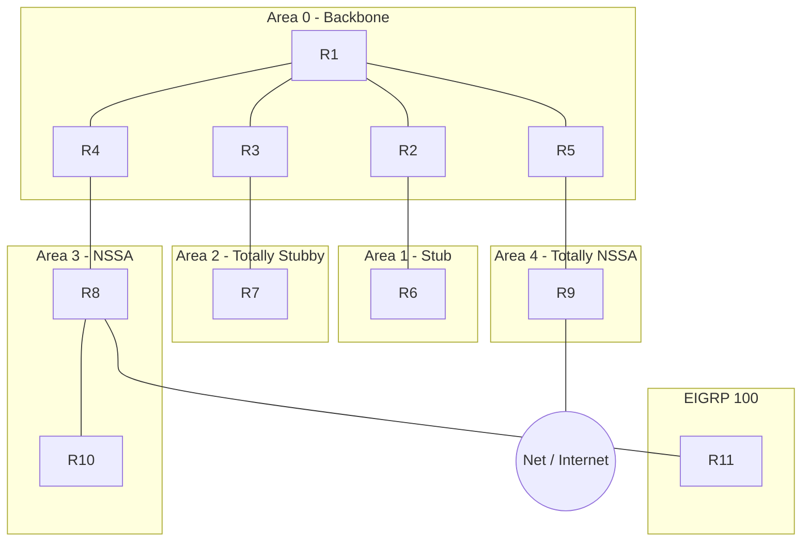

# OSPFv2 Area Types Lab: Stub, Totally Stubby, NSSA & Totally NSSA with an EIGRP Boundary


This repository contains the full architecture, Cisco IOS configurations, protocol behavioral analysis, a static config validator and Wireshark validation tasks for an **eleven-router OSPFv2 design** that uses **every classic area type**: Area 0 backbone, a **stub** area, a **totally stubby** area, an **NSSA** and a **totally NSSA**. It also includes an **EIGRP 100** domain redistributed at an NSSA ASBR and a simulated Internet edge, all inside a single **10.10.0.0/16** address block.

> Replace `OWNER/REPO` in the badge above with your GitHub path after publishing.

---

## 📋 Overview & Design Objectives

* **Hierarchical Addressing (`10.10.0.0/16`):**
  * **Aligned Area Blocks:** Each area owns one `/19`, so every ABR advertises exactly one summary route.
  * **VLSM Efficiency:** `/31` point-to-point links (RFC 3021), `/32` loopbacks, one `/24` simulated LAN and a `/30` to the Internet.
  * **Predictable Router-IDs:** Loopback0 doubles as the OSPF router-ID, and its last octet is the router number (R6 = `10.10.32.6`).
* **Every Area Type in One Topology:**
  * **Stub (Area 1):** blocks Type 4/5 LSAs, keeps inter-area routes.
  * **Totally stubby (Area 2):** `no-summary` on the ABR leaves one default route.
  * **NSSA (Area 3):** hosts the EIGRP ASBR; externals travel as Type 7 and are translated to Type 5 at R4.
  * **Totally NSSA (Area 4):** hosts the Internet ASBR with a minimal LSDB (Type 3 default plus Type 7).
* **Routing-Domain Boundaries:**
  * **EIGRP 100 behind R8:** one-way redistribution with a tagging route-map, and a default route sent back into EIGRP.
  * **Internet edge on R9:** static default originated into OSPF, with a `/16` static and a Null0 discard route to stop loops.
* **Operations Mindset:** point-to-point network type everywhere (no DR/BDR), `passive-interface default`, a 100 Gbps reference bandwidth, and an optional hardening template (SHA-256 authentication, BFD, SPF/LSA throttling).

---

## 📐 Network Topology




The same diagram, with interface names, is in [`docs/topology.mmd`](docs/topology.mmd).

---

## 🧭 Address Space Allocation

| Block | Use |
| :--- | :--- |
| `10.10.0.0/19` | **Area 0**: `10.10.0.0/24` loopbacks, `10.10.1.0/24` backbone links, `10.10.2.0/24` reserved for ABR-to-ABR links |
| `10.10.32.0/19` | **Area 1** (stub), summarized by R2 |
| `10.10.64.0/19` | **Area 2** (totally stubby), summarized by R3 |
| `10.10.96.0/19` | **Area 3** (NSSA), summarized by R4 |
| `10.10.128.0/19` | **Area 4** (totally NSSA), summarized by R5 |
| `10.10.160.0/19` | **EIGRP 100 domain**, summarized by R8 as an external route |
| `10.10.192.0/19` | Reserved for a future area |
| `10.10.224.0/19` | Reserved for management / services |
| `203.0.113.0/30` | R9 to Net (simulated Internet, outside the lab block) |

## 🏷️ Addressing Matrix & OSPF Interface Roles

| Node | Area | Interface | IP Address / Mask | OSPF Network Type | Role |
| :--- | :--- | :--- | :--- | :--- | :--- |
| **R1** | 0 | `Lo0`<br>`Gi0/0`<br>`Gi0/1`<br>`Gi0/2`<br>`Gi0/3` | `10.10.0.1/32`<br>`10.10.1.0/31`<br>`10.10.1.2/31`<br>`10.10.1.4/31`<br>`10.10.1.6/31` | Loopback<br>P2P to R2<br>P2P to R3<br>P2P to R4<br>P2P to R5 | Backbone internal (hub) |
| **R2** | 0 / 1 | `Lo0`<br>`Gi0/0`<br>`Gi0/1` | `10.10.0.2/32`<br>`10.10.1.1/31`<br>`10.10.33.0/31` | Loopback<br>P2P to R1 (A0)<br>P2P to R6 (A1) | **ABR** (Area 1, stub) |
| **R3** | 0 / 2 | `Lo0`<br>`Gi0/0`<br>`Gi0/1` | `10.10.0.3/32`<br>`10.10.1.3/31`<br>`10.10.65.0/31` | Loopback<br>P2P to R1 (A0)<br>P2P to R7 (A2) | **ABR** (Area 2, totally stubby) |
| **R4** | 0 / 3 | `Lo0`<br>`Gi0/0`<br>`Gi0/1` | `10.10.0.4/32`<br>`10.10.1.5/31`<br>`10.10.97.0/31` | Loopback<br>P2P to R1 (A0)<br>P2P to R8 (A3) | **ABR** (Area 3, NSSA) / 7-to-5 translator |
| **R5** | 0 / 4 | `Lo0`<br>`Gi0/0`<br>`Gi0/1` | `10.10.0.5/32`<br>`10.10.1.7/31`<br>`10.10.129.0/31` | Loopback<br>P2P to R1 (A0)<br>P2P to R9 (A4) | **ABR** (Area 4, totally NSSA) / 7-to-5 translator |
| **R6** | 1 | `Lo0`<br>`Gi0/0` | `10.10.32.6/32`<br>`10.10.33.1/31` | Loopback<br>P2P to R2 | Internal (stub) |
| **R7** | 2 | `Lo0`<br>`Gi0/0` | `10.10.64.7/32`<br>`10.10.65.1/31` | Loopback<br>P2P to R3 | Internal (totally stubby) |
| **R8** | 3 | `Lo0`<br>`Gi0/0`<br>`Gi0/1`<br>`Gi0/2` | `10.10.96.8/32`<br>`10.10.97.1/31`<br>`10.10.97.2/31`<br>`10.10.161.0/31` | Loopback<br>P2P to R4<br>P2P to R10<br>EIGRP 100 to R11 (not in OSPF) | Internal (NSSA) / **ASBR** (EIGRP) |
| **R9** | 4 | `Lo0`<br>`Gi0/0`<br>`Gi0/1` | `10.10.128.9/32`<br>`10.10.129.1/31`<br>`203.0.113.1/30` | Loopback<br>P2P to R5<br>Static to Net (not in OSPF) | Internal (totally NSSA) / **ASBR** (Internet) |
| **R10** | 3 | `Lo0`<br>`Gi0/0` | `10.10.96.10/32`<br>`10.10.97.3/31` | Loopback<br>P2P to R8 | Internal (NSSA) |
| **R11** | EIGRP | `Lo0`<br>`Lo1`<br>`Gi0/0` | `10.10.160.11/32`<br>`10.10.162.1/24`<br>`10.10.161.1/31` | Loopback<br>Simulated LAN<br>EIGRP 100 to R8 | EIGRP leaf |
| **Net** | none | `Lo0`<br>`Gi0/0` | `8.8.8.8/32`<br>`203.0.113.2/30` | Loopback<br>Static to R9 | Simulated Internet |

---

## 🧪 Deep-Dive Area Type Comparison

| Feature / Behavior | Stub (Area 1) | Totally stubby (Area 2) | NSSA (Area 3) | Totally NSSA (Area 4) |
| :--- | :--- | :--- | :--- | :--- |
| **Type 3 inter-area LSAs** | Yes | Default only | Yes | Default only |
| **Type 4 / Type 5 LSAs** | Blocked | Blocked | Blocked | Blocked |
| **Type 7 LSAs** | No | No | Yes | Yes |
| **Default route source** | ABR (automatic, Type 3) | ABR (automatic, Type 3) | ABR (`default-information-originate`, Type 7) | ABR (automatic, Type 3 via `no-summary`) |
| **ASBR allowed inside** | No | No | Yes (R8, EIGRP) | Yes (R9, Internet) |
| **ABR configuration** | `area 1 stub` | `area 2 stub no-summary` | `area 3 nssa default-information-originate` | `area 4 nssa no-summary` |
| **Internal router config** | `area 1 stub` | `area 2 stub` | `area 3 nssa` | `area 4 nssa` |
| **Hello options bits** | E cleared | E cleared | E cleared, N set | E cleared, N set |

### Key Design Points

1. **Area type follows the content.** Areas with an ASBR must be NSSA (R8 and R9). Single-exit leaf areas with no external routes are stub or totally stubby (R6, R7).
2. **`no-summary` goes on the ABR only.** Internal routers use plain `stub` or `nssa`; the flag is not carried in Hellos, but a mismatch in the area type itself drops the adjacency.
3. **Two translators, two paths.** R4 and R5 are the only ABRs of their NSSAs, so each is automatically the Type 7 to Type 5 translator.
4. **Single points of failure are deliberate.** R1 is the only backbone hub and every area is single-homed. `10.10.2.0/24` is reserved for ABR-to-ABR links if you extend the lab.
5. **Static default on R9 needs a `/16` static.** Without it the static default (AD 1) beats the OSPF default and sends internal traffic to Net, which returns it. A Null0 discard on R5 stops unallocated space from bouncing between R5 and R9.
6. **Expected LSDB.** See the per-area table in [`docs/04-verification-and-troubleshooting.md`](docs/04-verification-and-troubleshooting.md).

---

## ✅ Verification Quick Reference

| Check | Expected result |
| :--- | :--- |
| OSPF neighbor counts | R1 4, R2 2, R3 2, R4 2, R5 2, R6 1, R7 1, R8 2, R9 1, R10 1 (all `FULL`, no DR/BDR) |
| R7 (totally stubby) | Connected routes plus `O*IA 0.0.0.0/0` only |
| R6 (stub) | `O IA` routes plus `O*IA 0.0.0.0/0`; no `E` routes |
| R10 (NSSA) | `O IA` routes, `O N2 10.10.160.0/19`, `O*N2 0.0.0.0/0` |
| R9 (totally NSSA) | `S* 0.0.0.0/0` via Net and `S 10.10.0.0/16` via R5 |
| R1 | `O IA` summary for each area, `O E2 10.10.160.0/19` via R4, `O*E2 0.0.0.0/0` via R5 |
| R11 | `D* 0.0.0.0/0` via R8 |
| End-to-end | `ping 10.10.96.10 source Loopback0` from R7; `ping 8.8.8.8 source Loopback1` from R11 |

> The expected results describe the intended behavior. They have been checked statically by the validator but are not captured from a live run, so confirm them in your own lab and tell me if your image differs.

Full details, failure tests and Wireshark tasks: [`docs/04-verification-and-troubleshooting.md`](docs/04-verification-and-troubleshooting.md).

---

## 🗂️ Repository Layout

```text
.
├── README.md
├── LICENSE
├── .gitignore
├── configs/
│   ├── R1.cfg ... R11.cfg, Net.cfg      one file per device
│   └── optional/hardening-template.cfg  authentication, BFD, throttling
├── docs/
│   ├── topology.png
│   ├── topology.mmd
│   ├── 01-topology-analysis.md
│   ├── 02-ip-addressing-plan.md
│   ├── 03-ospf-design-decisions.md
│   └── 04-verification-and-troubleshooting.md
├── captures/                            Wireshark capture guide (add your .pcapng files)
├── scripts/validate_lab.py              static config validator
├── tests/test_validate_lab.py           validator tests (good and deliberately broken configs)
└── .github/workflows/validate.yml
```

## 🚀 Getting Started

1. Build the topology in EVE-NG (or GNS3 / CML) exactly as drawn, using the interface names in [`docs/topology.png`](docs/topology.png).
2. Deploy in stages. Every config line is tagged with its phase, so you can paste a phase at a time:

   | Phase | Tag | What it adds |
   | :--- | :--- | :--- |
   | 1 | `[P1]` | Interface addressing |
   | 2 | `[P2]` | OSPF baseline, all areas plain |
   | 3 | `[P3]` | Area types (change both ends of an area together) |
   | 4 | `[P4]` | ABR and ASBR summarization |
   | 5 | `[P5]` | EIGRP domain and redistribution |
   | 6 | `[P6]` | Internet edge and loop prevention |
   | 7 | optional | [`configs/optional/hardening-template.cfg`](configs/optional/hardening-template.cfg) |

   Verify neighbors and loopback pings after Phase 2 before moving on, and check each later phase against [`docs/04-verification-and-troubleshooting.md`](docs/04-verification-and-troubleshooting.md). If your IOS image rejects a command, check the notes in [`docs/03-ospf-design-decisions.md`](docs/03-ospf-design-decisions.md).
3. Run the validator locally at any time:

   ```bash
   python scripts/validate_lab.py configs
   python -m unittest discover -s tests -v
   ```

The validator confirms router-IDs, unique addressing, `/31` link consistency, area blocks, area-type flags and `no-summary` placement, ASBR placement, range coverage, the EIGRP boundary and the Internet-edge loop prevention. It does not emulate OSPF, so it complements the live checks rather than replacing them. GitHub Actions runs it on every push and pull request.

## 🔭 Possible Extensions

* Add ABR-to-ABR links in `10.10.2.0/24` and observe the cost-based path changes.
* Dual-home Area 3 to a second ABR and compare Type 7 to Type 5 translator election.
* Add a second EIGRP boundary router and switch to mutual redistribution with tag-based filtering.
* OSPF authentication (HMAC-SHA-256 key chains) and BFD on transit links.
* Convert the lab to OSPFv3 / dual-stack.

## 📄 License

Released under the [MIT License](LICENSE).
