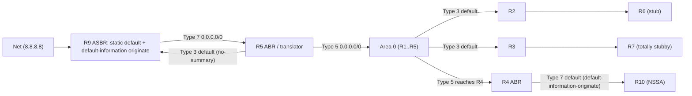

# 03 - OSPF Design Decisions

Why each area has the type it has, how routes and defaults flow, and which alternatives were rejected.

## Area plan

| Area | Routers | Type | Reason |
| :--- | :--- | :--- | :--- |
| 0 | R1, R2, R3, R4, R5 | Backbone | Transit |
| 1 | R2 (ABR), R6 | **Stub** | No externals needed; inter-area routes kept for optimal exit choice |
| 2 | R3 (ABR), R7 | **Totally stubby** | Single exit, so a default route is all R7 needs |
| 3 | R4 (ABR), R8 (ASBR), R10 | **NSSA** | Contains the EIGRP ASBR; externals travel as Type 7 |
| 4 | R5 (ABR), R9 (ASBR) | **Totally NSSA** | Contains the Internet ASBR; minimal LSDB |

## LSA types per area

| Area | Type 1 | Type 2 | Type 3 | Type 5 | Type 7 |
| :--- | :--- | :--- | :--- | :--- | :--- |
| 0 | R1-R5 | none (all links are P2P) | One range per area (4 total) | `10.10.160.0/19` (R4), `0.0.0.0/0` (R5) | none |
| 1 | R2, R6 | none | All inter-area routes plus a default | blocked | none |
| 2 | R3, R7 | none | **Default only** | blocked | none |
| 3 | R4, R8, R10 | none | All inter-area routes | blocked | `10.10.160.0/19` (R8), `0.0.0.0/0` (R4) |
| 4 | R5, R9 | none | **Default only** | blocked | `0.0.0.0/0` (R9) |

## Default route flow



* R2 and R3 originate a Type 3 default into their areas automatically.
* R4 does not receive Type 5 LSAs inside Area 3, so it injects a **Type 7 default** with `default-information-originate`. Without it R10 would have no default route.
* R5 sends a Type 3 default into Area 4 through `no-summary`, so R9 does not need a separate default injection.

## External routes: EIGRP

```text
R11 (EIGRP 100)  ->  R8 (ASBR)  ->  Type 7 in Area 3  ->  R4 translates  ->  Type 5 in Area 0
```

| Decision | Choice | Reason |
| :--- | :--- | :--- |
| Redistribution direction | **EIGRP to OSPF, one way**, plus a default route into EIGRP | One boundary router and a leaf EIGRP domain: no feedback loop and no need to learn OSPF routes in EIGRP |
| Route marking | `route-map EIGRP-TO-OSPF` sets tag 100 | Keeps filtering simple if a second boundary router is added later |
| Summarization | `summary-address 10.10.160.0 255.255.224.0` on R8 | One Type 7 route instead of one per EIGRP prefix |
| Metric type | Default (E2) | Single exit, so cost to the ASBR does not matter; use E1 once a second ASBR exists |
| Default route to R11 | `ip summary-address eigrp 100 0.0.0.0 0.0.0.0` on Gi0/2 | R11 only needs a default; suppresses everything else toward the leaf |

> On R11 the default route appears as `D*` (internal EIGRP route created by the summary), not `D*EX`.

## Internet edge

| Item | Design | Reason |
| :--- | :--- | :--- |
| R9 static default via Net | `ip route 0.0.0.0 0.0.0.0 203.0.113.2` | Source of the Internet default |
| R9 `default-information originate` | Originates Type 7 into the totally NSSA | Makes R9 the exit for the whole domain |
| R9 static `10.10.0.0/16` via R5 | Prevents the static default (AD 1) from beating the OSPF default for internal traffic | Without it R9 sends internal packets to Net, which routes them straight back |
| R5 `ip route 10.10.0.0 255.255.0.0 Null0` | Discard route | Stops unallocated lab space from bouncing between R5 and R9 |
| Net return route | `10.10.0.0/16` via R9 | Replies to Internet pings need a path home |

## Interface and process design

| Setting | Value | Reason |
| :--- | :--- | :--- |
| Network type | `point-to-point` on all links | No DR/BDR election, no Type 2 LSAs, faster adjacency |
| Passive interfaces | `passive-interface default`, then `no passive-interface` on transit links | Loopbacks are advertised without forming adjacencies |
| Reference bandwidth | `auto-cost reference-bandwidth 100000` | Gigabit links get a cost greater than 1, so costs still differentiate |
| Activation | `ip ospf 1 area X` per interface | No wildcard mistakes |
| Router-ID | Explicit, equal to Loopback0 | Stable and readable |

## Alternatives considered

| Alternative | Why it was not used |
| :--- | :--- |
| Make Area 3 a stub area | Not possible: it contains an ASBR |
| Make Area 3 totally NSSA | Possible, but then R10 sees only a default and no inter-area detail; plain NSSA keeps the contrast with Area 4 |
| Redistribute mutually between EIGRP and OSPF | Unnecessary with one boundary and a leaf EIGRP domain; adds loop risk without benefit |
| A default originated at R5 instead of R9's Type 7 | Fallback only (commented in `R5.cfg`) if translation of the default does not occur on your image |
| Virtual links | Not needed: Area 0 is contiguous |

## Image notes and gotchas

* **Type 7 default translation.** Behavior for a Type 7 default LSA translated to Type 5 can differ between images. After building, check `show ip ospf database external 0.0.0.0` on R1. If R9's default is missing, use the two commented `[P6] FALLBACK` lines in `configs/R5.cfg`.
* **Area-type flags.** Change both ends of an area together: a stub or NSSA mismatch drops the adjacency. `no-summary` is configured on the ABR only.
* **Forwarding address.** NSSA external routes carry a forwarding address in their Type 7 LSA. It must be reachable from Area 0 (it is, because each ABR summarizes its area's links).
* **Authentication.** HMAC-SHA-256 key chains need IOS 15.4(1)T or later. The hardening template includes an MD5 fallback.
